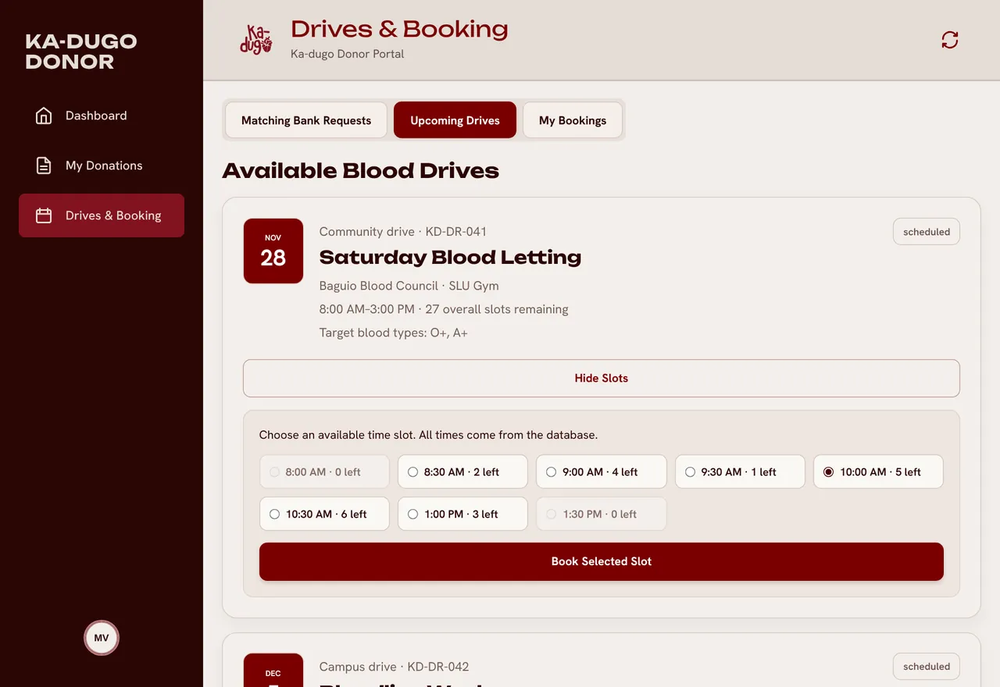
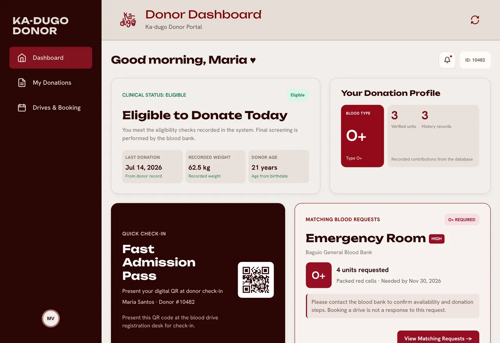
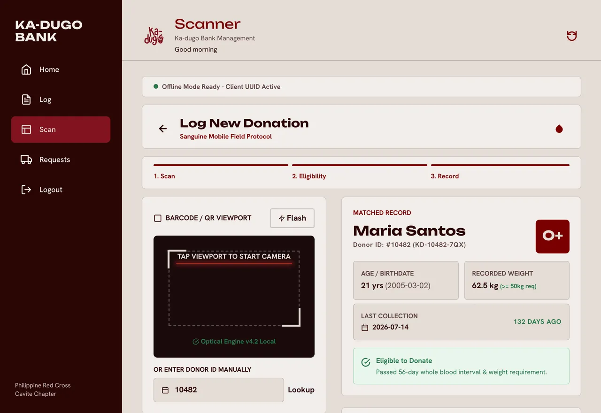

<p align="center">
  
</p>

<h3 align="center">Find a drive. Show your pass. Give blood, even with no signal.</h3>

<p align="center">
  A blood donation web app that installs like a phone app. Donors book a drive and carry a QR pass;
  organizers run the drives; blood banks scan donors in, check eligibility and log every donation,
  online or off.
</p>

<p align="center">
  
  
  
</p>

---

## What it does

Ka-dugo connects the three groups a blood drive needs, each with its own portal:

| Role | What they do |
| --- | --- |
| **Donor** | Sees whether they're eligible today, finds nearby drives and books a time slot, answers urgent blood requests that match their type, and carries a QR **Fast Admission Pass** for check-in. Keeps a history of every donation. |
| **Organizer** | Schedules drives with time slots and target blood types, and sends alerts to donors. |
| **Blood bank** | Tracks stock against daily quotas, posts and manages blood requests, and keeps the donation log. |
| **Phlebotomist** | Works the scanner at the drive: scan a donor's QR (or type their ID), see their record and eligibility, then record the donation. |
| **Admin** | Uses the blood bank tools, starting from the bank dashboard. |

Everyone signs in on one page and is sent to their own portal based on their role.

## Works offline

Drives happen in gyms and halls where the signal drops, so the scanner keeps working without a connection:

- **Service worker** (`sw.js`): pages and assets are served network-first with a cached fallback, and the last good API response is kept so screens still show data offline. If a page was never cached, you get `offline.html` instead of an error.
- **Offline donation queue** (`js/db.js`, `js/sync.js`): donations recorded offline go into IndexedDB (`KadugoOfflineDB`). Each one carries a client-generated UUID that the database keeps unique, so when the connection comes back they sync automatically and a resent donation is never logged twice.
- **Installable**: a web app manifest and app icons, so it can be added to a phone's home screen.

## Eligibility rules

Checked on the server (`api/eligibility.php`) every time a donor is looked up:

- at least **56 days** since their last whole-blood donation
- aged **16 to 65**
- weighs at least **50 kg**
- no active **deferral** on record

When a donor isn't eligible, the app says why and when they can donate next.

## Tech stack

| Layer | Tech |
| --- | --- |
| Front end | HTML, CSS (design tokens in `css/tokens.css`), vanilla JavaScript with ES modules |
| Back end | PHP 8 (`mysqli`, sessions), one JSON endpoint per resource in `api/` |
| Database | MySQL / MariaDB, 17 tables (`database/kadugo.sql`) |
| Offline | Service worker, IndexedDB, Web App Manifest |
| Type | Unbounded (headings) and Hanken Grotesk (text), self-hosted in `assets/fonts` |

## Run it locally

You need a local PHP + MySQL server. These steps use [WampServer](https://www.wampserver.com/) on Windows; XAMPP works the same way.

1. Put the project in the web root, for example `C:\wamp64\www\kadugo-pwa`.
2. Open phpMyAdmin, create a database named `kadugo_db`, and import `database/kadugo.sql`. It comes with sample accounts, drives and donations.
3. Check the connection settings at the top of `api/config.php` (`DB_HOST`, `DB_USER`, `DB_PASS`, `DB_NAME`, `DB_PORT`) and change them if your MySQL setup differs.
4. Open <http://localhost/kadugo-pwa/> and sign in.

Service workers only run on `localhost` or HTTPS, so test offline mode through `localhost`, not by opening the files directly.

## Project structure

```
kadugo-pwa/
├── index.html            sign-in page
├── offline.html          shown when you're offline and a page isn't cached
├── manifest.json         install details and app icons
├── sw.js                 service worker: caching and offline fallbacks
├── api/                  PHP endpoints (JSON in, JSON out)
│   ├── config.php        database connection and shared headers
│   ├── login.php         sign-in and role-based redirect
│   ├── donor_portal.php  everything the donor screens need
│   ├── drives.php        drives and time slots
│   ├── donors.php        donor lookup for the scanner
│   ├── donations.php     recording donations (also receives offline syncs)
│   ├── eligibility.php   the eligibility rules above
│   └── …                 alerts, requests, registrations, profile, dashboard
├── pages/
│   ├── donor/            dashboard, drives and booking, donations, notifications, profile
│   ├── organizer/        drives, alerts, account
│   └── bank/             dashboard, requests, active requests, donation log, scanner
├── js/                   page scripts, offline queue (db.js, sync.js), shared UI helpers
├── css/                  tokens, base styles and one stylesheet per page group
├── assets/               fonts and icons
└── database/kadugo.sql   schema and sample data
```

## Team

Built for **IT312 Web Technologies** at Saint Louis University, 2026, by:

- Denver C. Balunatse
- El Steven D. Cruz
- Prince Hermione P. Dela Cruz
- Hans Rainier F. Fernandez
- Shanelle Margaret T. Navarro
- Ethan Christan M. Villegas

A redesign for the finals is in progress on the `frontend-finals-redesign` branch.
